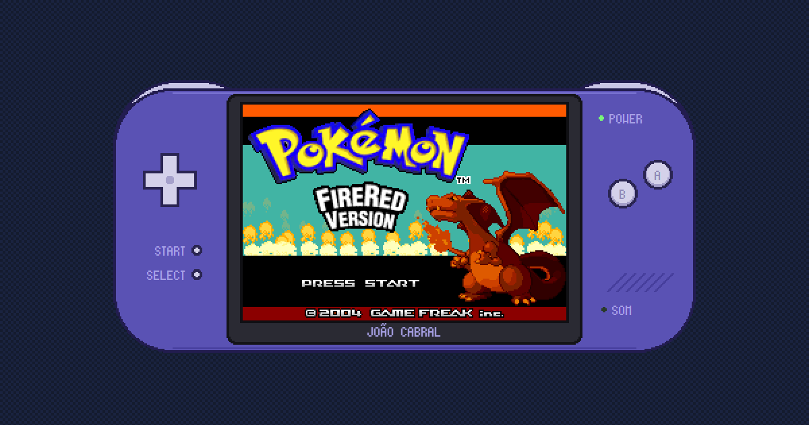

# JOÃO CABRAL · Pokémon Center

A playable portfolio: a Pokémon Center from **Pokémon FireRed**, running inside a Game Boy Advance in the browser. Walk around the room, talk to the people in it, or press START to get straight to the projects, the experience and the contact info.



## What it is

- **A room you can walk around:** the real FireRed Pokémon Center, with the Nurse, the people and the objects. Arrow keys/WASD, a click or a tap to walk there, A or a click to talk.
- **A START menu for the fast path:** PROJETOS, SOBRE, EXPERIÊNCIA, HABILIDADES, CONTATO and OPÇÕES, each drawn like the matching FireRed screen, with a help bar that explains every item in plain language. Direct links (`#/contato`, `#/projetos/3`) open a screen straight away.
- **Projects as Pokémon:** PROJETOS is the Pokédex list, and each project opens as a Pokémon summary with three pages (info, pictures, tech stack), the Pokémon's cry and a 1 in 16 chance of a shiny. Screenshots open full size over the page.
- **The room opens the same screens:** the Nurse asks what you need (heal, about João, contact), the PC opens the Box where you put projects in your team (up to 6) and the Nurse heals them on the machine, the Kanto map opens the experience Bag and the Move Tutor the skills TM Case. SOBRE is the trainer card (it flips like the game's), EXPERIÊNCIA the Bag with WORK and EDUCATION pockets, HABILIDADES the TM Case with a disc per skill in its type's colour.
- **Music made from the game's own data:** the GAME FREAK theme, the title, the Pokémon Center and the healing jingle are synthesized in the browser from the decompilation's MIDI files and instrument bank, played the way the GBA's m4a engine plays them (sample and GB channels, envelopes, vibrato, loop points). Off until you turn the sound on.
- **A simple view for reading:** the SIMPLE button on the console (or the `#/simples` link) turns the whole portfolio into a regular page to scroll, still in the game's font, frames and sprites, in Portuguese or English.
- **A landing page for a quick read** (`lp.html`, in progress): a vertical page in its own collage style (orange, purple, green and black; paper and tape, shapes with eyes that follow the pointer, a low poly 3D piece, pixel stickers and real data from the repos), with every project, the experience, the skills and the contact, and the GBA one click away. It reads the same `data.js`.
- **A living Kanto behind the console:** Route 1, Pallet Town and the sea from the game's own maps, with animated water and flowers, the town's people walking around and a slow camera.
- **A console around the game:** a geometric GBA on desktop and an opened GBA SP on phones held upright, both clickable, at integer pixel scales so every pixel stays sharp, with a word next to A and B that says what each button does right now (TALK, RUN, CHOOSE, BACK...).

## Faithful to the game

The goal is that it feels like the actual game, so the numbers come from the community decompilation of FireRed ([pret/pokefirered](https://github.com/pret/pokefirered)), not from eyeballing screenshots:

- the message box frame, text position (16, 121), 15 px line spacing, text colours per speaker and the bouncing arrow;
- the START menu, help bar, OPTION screen and multichoice windows (window templates, cursor, wrapping, which sounds play and which don't);
- the Pokédex list (row layout, type labels, white fades) and the Pokémon summary (backgrounds and tabs from the tilemaps, the shiny palettes, the sprite bounce, the page slide);
- the trainer card (palettes by stars, rows, badge slots, the flip timing and its three sounds), the Bag (list scrolling rule, bag shake and hop, pocket switch) and the TM Case (disc colours and drop/raise);
- the PC Box (layout, scrolling background, hand cursor, the team panel dropping in 20 frames) and the healing machine (ball timing, glow palettes, monitor flicker, the Nurse's bow);
- the music engine: 24 ticks a beat at the GBA's frame rate, 5 DirectSound channels with their envelopes and the 8-bit mixer clip, the four GB channels, the triangle LFO, the song reverb;
- the page background: the stacked maps, the border block, tileset animation timing and the wander movement of the people;
- the title screen layers, the flame sprites (same random generator, seed and sprite limit), the shine on the logo and the PRESS START blink;
- text speeds, wall-bump timing and the cry and white fade when you press START on the title.

The message box was checked pixel by pixel against a reference rendered with the game's own text-printer rules.

## Built with

- HTML, CSS and JavaScript (ES modules): no framework, no dependencies, no build step for the site.
- A Python asset pipeline (`tools/build_assets.py`, standard library + fontTools) that renders tilemaps, palettes, fonts, sounds and the room from the decompilation's data.
- Tests: `check.mjs` (logic, content and text that must fit each window) and `tools/e2e.mjs` (end-to-end flows in headless Edge/Chrome over the DevTools protocol).

## Running it

```bash
python -m http.server 8123      # any static server works
# open http://127.0.0.1:8123
```

```bash
node check.mjs                  # logic, data and text widths
node tools/e2e.mjs              # end-to-end flows (needs Edge or Chrome; EDGE=<path> to override)
node tools/shots.mjs shots/     # screenshots at desktop, laptop and phone sizes
```

Rebuilding `assets/` needs the decompilation and the sound rip in `new assets/` (not included): `pip install -r tools/requirements.txt`, then `python tools/build_assets.py`.

### Controls

| Button | Keyboard | Mouse / touch |
|---|---|---|
| A | Z, Space, Enter | left click / tap |
| B | X, Backspace | right click |
| START | Esc | the START button |
| D-pad | arrows, WASD | the d-pad, or click the floor |

## Structure

```
index.html  style.css  gba.js        the console: body, scaling, input, sound, links
carts/center/                         the cartridge: title, room, dialogue, menu and screens
data.js                               all the content (projects, experience, skills, texts)
logic.js  sound.js  typewriter.js     shared logic, sounds, typing effect
music.js                              the music synthesizer
lp.html  site/                       the landing page: sections, the cast of shapes, the 3D piece
kanto.js  simple.js                   the page background, the simple view
assets/                               generated from the game's data by tools/build_assets.py
tools/                                asset build, repo numbers (github_stats.mjs), tests, screenshots
docs/                                 design specs and implementation plans
```

## Legal

Pokémon and all related names, graphics, sounds and characters are © Nintendo, Creatures Inc. and GAME FREAK inc. This is a non-commercial fan project made as a personal portfolio; the game assets in `assets/` are derived from the decompilation and are **not** covered by this repository's license. The source code is released under the [MIT License](LICENSE).

## Author

**João Cabral**: [GitHub](https://github.com/thxcabra) · [LinkedIn](https://www.linkedin.com/in/joao-cabral-machado/)
